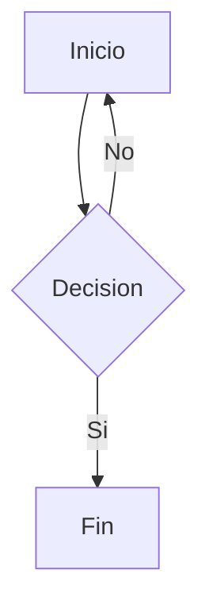
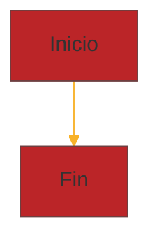

# Sintaxis Avanzada de Markdown — Referencia Completa

Contenido avanzado: formulas matematicas (KaTeX/MathJax), diagramas Mermaid, y MDX (Markdown + JSX).

---

## 1. Matematicas con KaTeX y MathJax

Markdown no incluye soporte nativo para formulas matematicas. Librerias como **KaTeX** y **MathJax** permiten renderizar notacion LaTeX en documentos Markdown.

### Sintaxis basica

| Tipo | Sintaxis | Ejemplo |
|------|----------|---------|
| Formula inline | `$...$` | `$E = mc^2$` → E = mc² |
| Formula bloque | `$$...$$` | `$$\sum x_i$$` → formula centrada |

### Referencia de comandos LaTeX

#### Operaciones basicas

| Comando | Resultado |
|---------|-----------|
| `a + b` | a + b |
| `a - b` | a - b |
| `a \times b` | a × b |
| `a \cdot b` | a · b |
| `a \div b` | a ÷ b |
| `\frac{a}{b}` | a/b (fraccion) |
| `a^2` | a² (potencia) |
| `a_i` | a_i (subindice) |
| `a^{2n+1}` | a^(2n+1) |
| `a_{i,j}` | a_(i,j) |

#### Raices

| Comando | Resultado |
|---------|-----------|
| `\sqrt{x}` | √x |
| `\sqrt[3]{x}` | ∛x |
| `\sqrt[n]{x}` | ∜x |

#### Letras griegas

| Comando | Resultado | Comando | Resultado |
|---------|-----------|---------|-----------|
| `\alpha` | α | `\beta` | β |
| `\gamma` | γ | `\delta` | δ |
| `\epsilon` | ε | `\varepsilon` | ε |
| `\zeta` | ζ | `\eta` | η |
| `\theta` | θ | `\vartheta` | ϑ |
| `\iota` | ι | `\kappa` | κ |
| `\lambda` | λ | `\mu` | μ |
| `\nu` | ν | `\xi` | ξ |
| `\pi` | π | `\rho` | ρ |
| `\sigma` | σ | `\tau` | τ |
| `\upsilon` | υ | `\phi` | φ |
| `\varphi` | φ | `\chi` | χ |
| `\psi` | ψ | `\omega` | ω |
| `\Gamma` | Γ | `\Delta` | Δ |
| `\Theta` | Θ | `\Lambda` | Λ |
| `\Xi` | Ξ | `\Pi` | Π |
| `\Sigma` | Σ | `\Phi` | Φ |
| `\Psi` | Ψ | `\Omega` | Ω |

#### Relaciones y comparaciones

| Comando | Resultado |
|---------|-----------|
| `a = b` | a = b |
| `a \neq b` | a ≠ b |
| `a < b` | a < b |
| `a > b` | a > b |
| `a \leq b` | a ≤ b |
| `a \geq b` | a ≥ b |
| `a \approx b` | a ≈ b |
| `a \equiv b` | a ≡ b |
| `a \propto b` | a ∝ b |
| `a \ll b` | a ≪ b |
| `a \gg b` | a ≫ b |

#### Conjuntos

| Comando | Resultado |
|---------|-----------|
| `\in` | ∈ |
| `\notin` | ∉ |
| `\subset` | ⊂ |
| `\subseteq` | ⊆ |
| `\cup` | ∪ |
| `\cap` | ∩ |
| `\emptyset` | ∅ |
| `\mathbb{R}` | ℝ |
| `\mathbb{N}` | ℕ |
| `\mathbb{Z}` | ℤ |
| `\forall` | ∀ |
| `\exists` | ∃ |

#### Sumatorios, productorios e integrales

```latex
\sum_{i=1}^{n} x_i              % Sumatorio
\prod_{i=1}^{n} x_i             % Productorio
\int_a^b f(x)\,dx               % Integral definida
\iint_D f(x,y)\,dA              % Integral doble
\iiint_V f(x,y,z)\,dV           % Integral triple
\oint_C \vec{F} \cdot d\vec{r}  % Integral de linea
\lim_{x \to \infty} f(x)        % Limite
```

#### Matrices

```latex
% Con parentesis
\begin{pmatrix}
a & b \\
c & d
\end{pmatrix}

% Con corchetes
\begin{bmatrix}
1 & 0 & 0 \\
0 & 1 & 0 \\
0 & 0 & 1
\end{bmatrix}

% Determinante (barras verticales)
\begin{vmatrix}
a & b \\
c & d
\end{vmatrix}
= ad - bc
```

#### Sistemas de ecuaciones

```latex
f(x) = \begin{cases}
x^2 & \text{si } x \geq 0 \\
-x & \text{si } x < 0
\end{cases}
```

#### Ecuaciones alineadas

```latex
\begin{aligned}
(x + y)^2 &= (x + y)(x + y) \\
         &= x^2 + 2xy + y^2
\end{aligned}
```

#### Acentos y decoraciones

| Comando | Resultado |
|---------|-----------|
| `\hat{x}` | x̂ |
| `\bar{x}` | x̄ |
| `\tilde{x}` | x̃ |
| `\vec{v}` | v⃗ |
| `\dot{x}` | ẋ |
| `\ddot{x}` | ẍ |
| `\overline{AB}` | AB̅ |
| `\overbrace{a+b+c}^{\text{suma}}` | Llave superior |
| `\underbrace{a+b+c}_{\text{suma}}` | Llave inferior |

#### Parentesis ajustables

Usa `\left` y `\right` para que los delimitadores se ajusten automaticamente:

```latex
\left( \frac{a}{b} \right)        % Parentesis ajustados
\left[ \frac{a}{b} \right]        % Corchetes ajustados
\left\{ \frac{a}{b} \right\}      % Llaves ajustadas
\left| \frac{a}{b} \right|        % Valor absoluto
\left\| \vec{v} \right\|          % Norma
```

#### Texto dentro de formulas

```latex
x = 5 \quad \text{si y solo si} \quad y = 10
```

Espaciado: `\,` (fino), `\;` (medio), `\quad` (grande), `\qquad` (doble).

### KaTeX

Libreria rapida para renderizar notacion matematica en la web.

**Instalacion desde CDN:**

```html
<link rel="stylesheet" href="https://cdn.jsdelivr.net/npm/katex@0.16.9/dist/katex.min.css">
<script defer src="https://cdn.jsdelivr.net/npm/katex@0.16.9/dist/katex.min.js"></script>
<script defer src="https://cdn.jsdelivr.net/npm/katex@0.16.9/dist/contrib/auto-render.min.js"
  onload="renderMathInElement(document.body);"></script>
```

### MathJax

Libreria mas completa pero mas lenta que KaTeX.

**Instalacion desde CDN:**

```html
<script>
MathJax = {
  tex: {
    inlineMath: [['$', '$'], ['\\(', '\\)']],
    displayMath: [['$$', '$$'], ['\\[', '\\]']]
  }
};
</script>
<script src="https://cdn.jsdelivr.net/npm/mathjax@3/es5/tex-mml-chtml.js"></script>
```

### KaTeX vs MathJax

| Caracteristica | KaTeX | MathJax |
|----------------|-------|---------|
| Velocidad | Muy rapido | Mas lento |
| Compatibilidad LaTeX | ~300 funciones | ~800 funciones |
| Renderizado | HTML/CSS | HTML/CSS/SVG/MathML |
| Tamaño | ~200 KB | ~500 KB |
| Accesibilidad | Basica | Avanzada (menu contextual) |
| Numeracion ecuaciones | No nativo | Si |

**Usa KaTeX** si la velocidad es prioritaria (blogs, documentacion).
**Usa MathJax** si necesitas compatibilidad total con LaTeX (articulos academicos).

### Plataformas compatibles

| Plataforma | Libreria | Sintaxis |
|------------|----------|----------|
| GitHub | MathJax | `$...$` y `$$...$$` |
| GitLab | KaTeX | `$...$` y `$$...$$` |
| Obsidian | MathJax | `$...$` y `$$...$$` |
| Jupyter Notebooks | MathJax | `$...$` y `$$...$$` |
| Notion | KaTeX | `$...$` o bloque de ecuacion |
| Typora | MathJax | `$...$` y `$$...$$` |

### Errores comunes

❌ **Espacios dentro de delimitadores:** `$ E = mc^2 $` (no funciona en algunos procesadores)
✅ **Sin espacios:** `$E = mc^2$`

❌ **Olvidar llaves en subindices:** `$x^10$` (solo eleva el 1)
✅ **Con llaves:** `$x^{10}$`

❌ **Salto de linea \\ fuera de entorno:** `\\` solo funciona dentro de `aligned`, `pmatrix`, `cases`, etc.

---

## 2. Diagramas con Mermaid

Mermaid permite crear diagramas desde codigo de texto. Se escribe dentro de un fenced code block con lenguaje `mermaid`.



### Tipos de diagrama

| Tipo | Identificador | Uso |
|------|---------------|-----|
| Diagrama de flujo | `graph` / `flowchart` | Procesos, algoritmos, workflows |
| Diagrama de secuencia | `sequenceDiagram` | Interacciones entre componentes |
| Diagrama de clases | `classDiagram` | Estructura de clases UML |
| Diagrama de estado | `stateDiagram` / `stateDiagram-v2` | Maquinas de estado |
| Diagrama ER | `erDiagram` | Entidad-Relacion (bases de datos) |
| Diagrama Gantt | `gantt` | Planificacion temporal |
| Diagrama de pastel | `pie` | Distribucion porcentual |
| Gitgraph | `gitGraph` | Ramas y commits de Git |
| Mapa mental | `mindmap` | Organizacion de ideas |
| Timeline | `timeline` | Linea de tiempo |
| Diagrama XY | `xychart` | Graficos de barras/lineas |
| Diagrama de requisitos | `requirementDiagram` | Requisitos de sistema |

### Sintaxis por tipo

#### Diagrama de flujo (Flowchart)

```
graph TD;
    A[Inicio] --> B{Decision};
    B -->|Si| C[Fin];
    B -->|No| D[Otra opcion];
    D --> A;
```

Orientaciones: `TD` (top-down), `LR` (left-right), `BT` (bottom-top), `RL` (right-left).

Formas de nodo:
- `A[Texto]` — rectangulo
- `A{Texto}` — rombo (decision)
- `A(Texto)` — bordes redondeados
- `A[[Texto]]` — subrutina
- `A(((Texto)))` — circulo
- `A>Texto]` — asimetrico
- `A[/Texto/]` — paralelogramo
- `A[\Texto\]` — paralelogramo inverso

#### Diagrama de secuencia

```
sequenceDiagram
    Alice->>John: Hola John, ¿como estas?
    John-->>Alice: Bien, gracias!
    Alice->>John: Puedes oirme?
    John-->>Alice: Si!
```

Participantes: `participant`, `actor`.
Tipos de linea: `->` (solida), `-->` (discontinua), `->>` (solida con flecha), `-->>` (discontinua con flecha), `-x` (con cruz), `--x` (discontinua con cruz).

#### Diagrama de clases

```
classDiagram
    class Animal {
        +String nombre
        +int edad
        +hacerSonido() void
    }
    class Perro {
        +ladrar() void
    }
    class Gato {
        +maullar() void
    }
    Animal <|-- Perro
    Animal <|-- Gato
```

Relaciones: `<|--` (herencia), `*--` (composicion), `o--` (agregacion), `-->` (asociacion), `..|>` (realizacion), `..>` (dependencia).

#### Diagrama Entidad-Relacion

```
erDiagram
    CLIENTE ||--o{ PEDIDO : realiza
    CLIENTE {
        int id PK
        string nombre
        string email
    }
    PEDIDO {
        int id PK
        date fecha
        decimal total
        int cliente_id FK
    }
```

Cardinalidad: `||` (uno), `o{` (cero o muchos), `|{` (uno o muchos), `}o` (cero o uno), `||--||` (uno a uno), `||--o{` (uno a muchos), `}o--o{` (muchos a muchos).

#### Diagrama de Gantt

```
gantt
    title Planificacion del Proyecto
    dateFormat  YYYY-MM-DD
    section Diseno
    Investigacion      :active, 2026-01-01, 14d
    Prototipo          :done, 2026-01-15, 10d
    section Desarrollo
    Frontend           :2026-01-25, 20d
    Backend            :2026-01-25, 20d
    Testing            :2026-02-14, 10d
```

Estados: `done` (completado), `active` (en progreso), `crit` (critico), `crit, active` (critico en progreso), `crit, done` (critico completado).

#### Mapa mental

```
mindmap
  root((Proyecto))
    Requisitos
      Funcionales
      No funcionales
    Diseno
      UX
      Arquitectura
    Desarrollo
      Frontend
      Backend
    Testing
```

#### Timeline

```
timeline
    title Historia de la Web
    1990 : WorldWideWeb
    1993 : Mosaic
    1998 : Google
    2004 : Facebook
    2007 : iPhone
```

### Personalizacion de temas

Mermaid se adapta automaticamente al tema del editor. Para configuracion manual:



Temas disponibles: `default`, `base`, `dark`, `forest`, `neutral`, `night`.

### Plataformas compatibles

| Plataforma | Soporte |
|------------|---------|
| GitHub | Nativo en .md, issues, PRs |
| GitLab | Nativo en archivos .md |
| Obsidian | Plugin nativo |
| Notion | Nativo (bloque de diagrama) |
| StackEdit | Extension |
| HackMD | Nativo |
| MkDocs | Plugin `mkdocs-mermaid2-plugin` |
| Docusaurus | Plugin `@docusaurus/theme-mermaid` |

---

## 3. MDX: Markdown con JSX

MDX es un formato que permite **combinar Markdown con componentes JSX de React** dentro del mismo documento.

### Sintaxis basica

```mdx
import { Grafico } from '../components/Grafico'

Este es un parrafo normal escrito en Markdown.

<Grafico datos={[1, 2, 3, 4, 5]} color="purple" />

Y aqui sigue mas texto en Markdown, con un [enlace](/sintaxis).
```

### Capacidades fundamentales

#### 1. Importar componentes

```mdx
import { MiComponente } from '../components/MiComponente'
import Layout from '../layouts/Layout'
```

#### 2. Usar componentes en el contenido

```mdx
# Titulo

Texto narrativo en Markdown.

<MiComponente prop="valor" activo={true} />

Mas texto que sigue al componente.
```

#### 3. Exportar datos

```mdx
export const meta = {
  titulo: 'Mi articulo',
  fecha: '2026-05-12',
  autor: 'Edu'
}

# {meta.titulo}

Publicado por {meta.autor} el {meta.fecha}.
```

### Ventajas

- Componentes reutilizables en toda la documentacion
- Interactividad real: graficos, formularios, sandboxes, reproductores
- Tipado estricto con TypeScript
- Acceso a todo el ecosistema React
- Frontmatter YAML + export programatico

### Versiones de MDX

| Version | Anio | Caracteristicas |
|---------|------|-----------------|
| MDX 1 | 2019 | Primera version estable. Limitaciones con lineas en blanco HTML |
| MDX 2 | 2022 | Reescritura completa. Parser mas estricto. Mejor rendimiento |
| MDX 3 | 2024 | Compatible con MDX 2. Mejoras en errores y rendimiento de build |

### Herramientas compatibles

| Herramienta | Plugin |
|-------------|--------|
| Next.js | `@next/mdx` |
| Astro | `@astrojs/mdx` |
| Docusaurus | Soporte nativo |
| Gatsby | `gatsby-plugin-mdx` |
| Remix | `@mdx-js/rollup` |
| VitePress | Soporte nativo |
| Nextra | Soporte nativo |

### Limitaciones

- NO es portable fuera del ecosistema React
- No se renderiza en GitHub, editores de texto plano, etc.
- Curva de aprendizaje mayor que Markdown puro
- El parser puede ser estricto con construcciones HTML
- Requiere proceso de build

---

## 4. Tabla Resumen de Sintaxis Avanzada

| Funcionalidad | Sintaxis | Plataformas |
|---------------|----------|-------------|
| Matematica inline | `$E = mc^2$` | GitHub, Obsidian, Notion |
| Matematica bloque | `$$\sum x_i$$` | GitHub, Obsidian, Notion |
| Diagrama flujo Mermaid | ` ```mermaid ... ``` ` | GitHub, GitLab, Obsidian |
| Diagrama secuencia Mermaid | ` ```mermaid sequenceDiagram``` ` | GitHub, GitLab, Obsidian |
| Diagrama Gantt Mermaid | ` ```mermaid gantt``` ` | GitHub, GitLab, Obsidian |
| MDX componente | `<Componente prop={val} />` | Next.js, Astro, Docusaurus |
| MDX import | `import X from './X'` | Next.js, Astro, Docusaurus |
| Frontmatter YAML | `---title:...---` | Jekyll, Hugo, Astro |
| Frontmatter TOML | `+++title=...+++` | Hugo, Zola |
